# Data and analysis code for DDP-guided residual reinforcement learning

This supplement contains the numerical data used in the simulation and
real-robot results of the accompanying paper. The directory structure follows
the paper's figures and tables, and all method names match the manuscript.

Controller and training code and trained models will be made publicly available
following acceptance. This release contains plotting code, derived summaries,
figures, and reduced motion traces for the replays below; raw robot logs are
not included.

## Real-robot motion replays

**Recorded on the physical robot, visualized in MuJoCo.** These animations
reconstruct measured joint motions from real-robot experiments in a simulation
model. All six controllers in Fig. 5 appear together in a three-column,
two-row layout: Nominal DDP, Friction DDP, Slotine–Li, DDP+GP, Joint velocity
control, and Proposed. Each method has its own color, with synchronized
end-effector and joint tracking-error curves from the same records.

The renderer uses recorded joint positions rather than a new dynamics rollout.
Playback is at **1x speed**, with the same camera, motion scale, and error axes.
Each panel retains its own trial's recorded reference and elapsed command time.

**Large figure-eight in the XZ plane**

[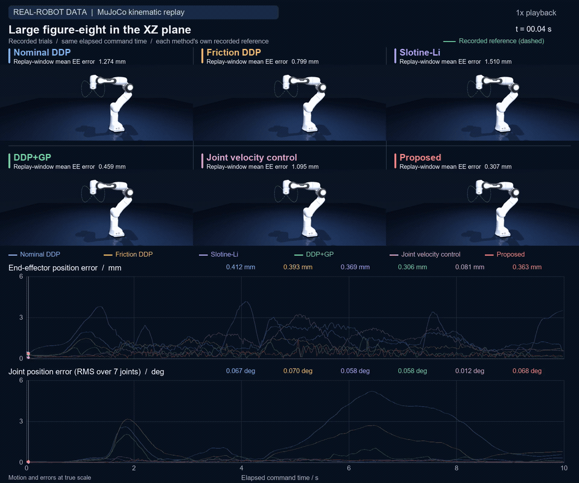](hardware/motion_replays/media/figure8_xz.mp4)

[Watch full-resolution MP4](hardware/motion_replays/media/figure8_xz.mp4)

**Circle in the XZ plane**

[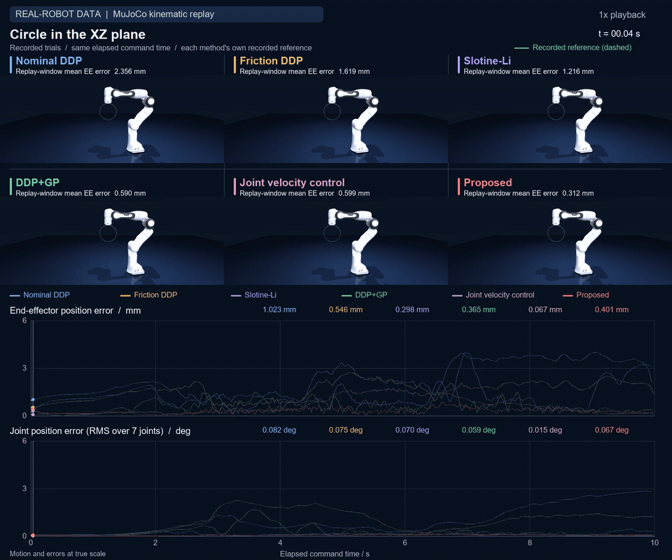](hardware/motion_replays/media/circle_xz.mp4)

[Watch full-resolution MP4](hardware/motion_replays/media/circle_xz.mp4)

**Ellipse in the YZ plane**

[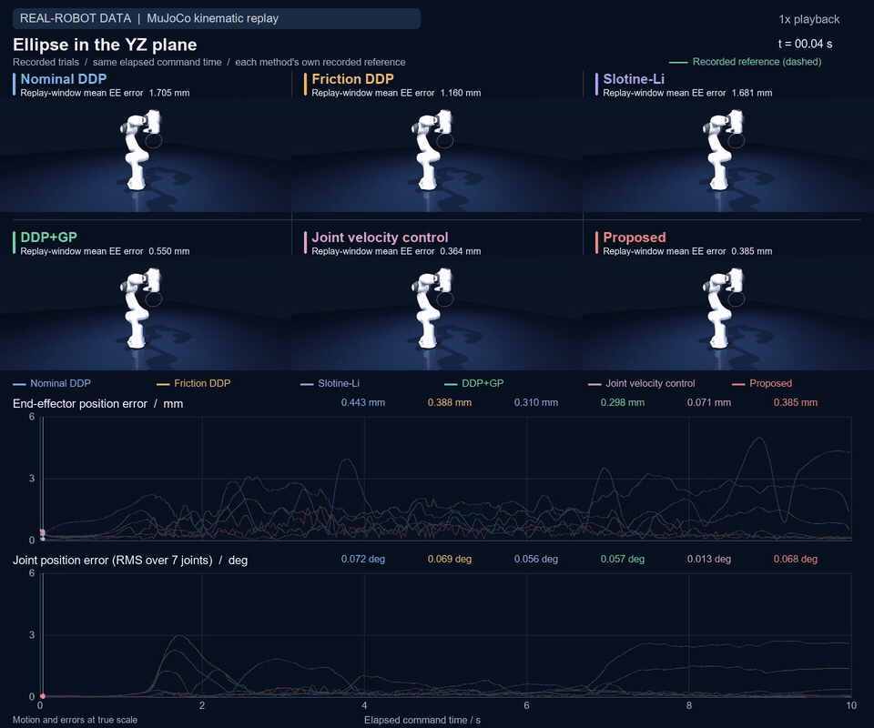](hardware/motion_replays/media/ellipse_yz.mp4)

[Watch full-resolution MP4](hardware/motion_replays/media/ellipse_yz.mp4)

These are selected, separately recorded trials. The displayed replay-window
errors describe these examples; the full experimental comparisons are provided
below. See the [replay gallery, data provenance, and rendering instructions](hardware/motion_replays/README.md)
for the recorded traces, sampling details, and downloadable videos.

## Hardware comparisons

Fig. 5 compares Nominal DDP, Friction DDP, Slotine–Li, DDP+GP,
Joint velocity control, and Proposed on 19 training and five held-out
trajectories. As reported in the manuscript, this comparison uses no added
payload. Fig. 6 shows the circular-trajectory example under the same reported
condition, and Fig. 7 compares the five torque controllers under unmodeled
payloads. Table V compares ZOH and interpolated residuals, with all other
controller and experimental settings held identical.

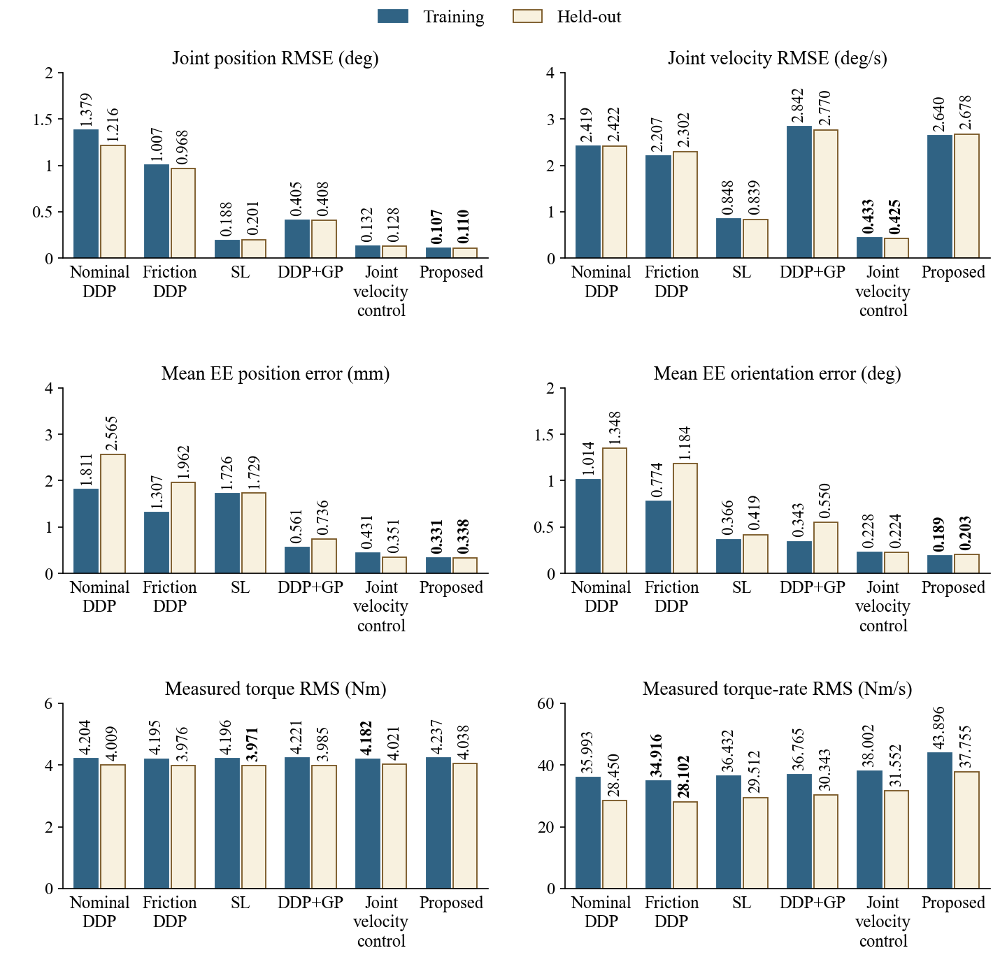

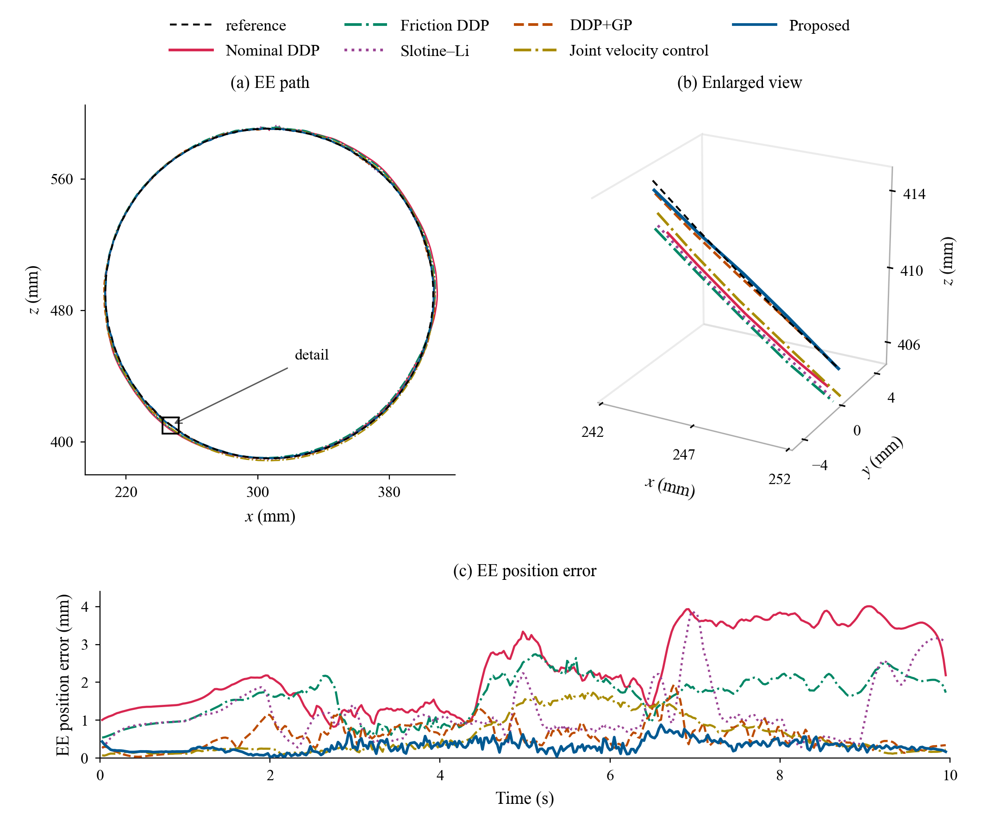

The [circular-trajectory data and plotting details](hardware/circular_trajectory/README.md)
reproduce the XZ projection, enlarged three-dimensional view, and EE position
error shown in Fig. 6.

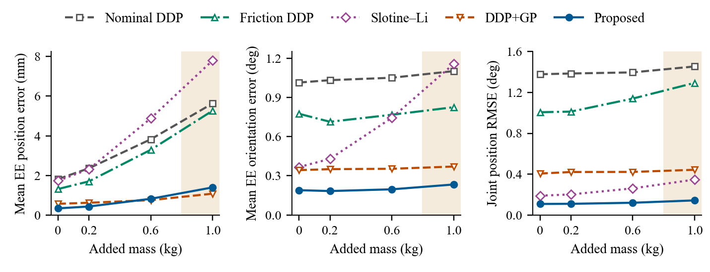

## Real-robot trajectory examples

The plots below show the same joint-space sinusoidal motion with a 1.0-kg
payload for all five methods in the payload experiment. These trials are part
of the released per-trajectory data used in Fig. 7; the payload is outside the
training randomization range.

| Nominal DDP | Friction DDP | Slotine–Li | DDP+GP | Proposed |
|---|---|---|---|---|
| 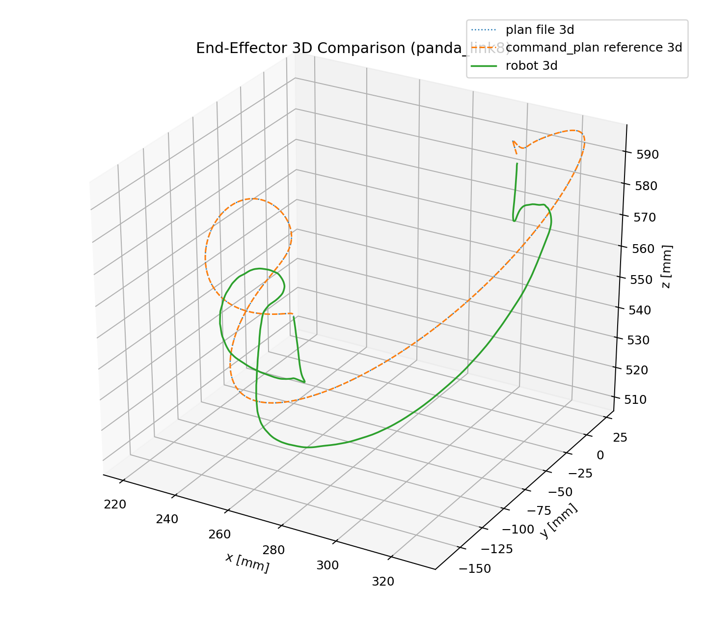 | 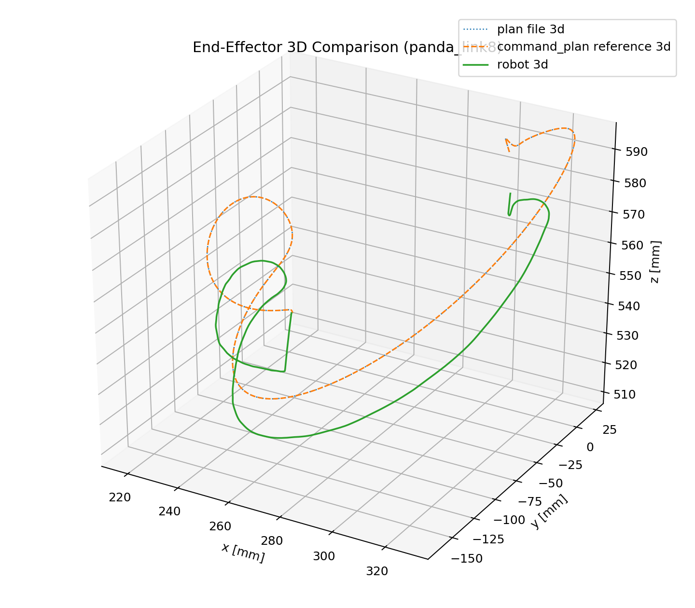 | 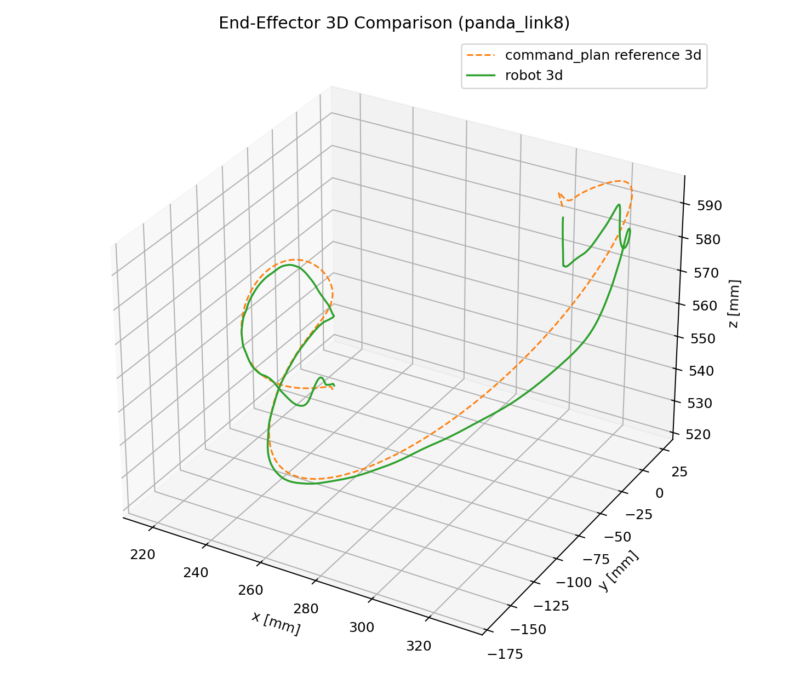 | 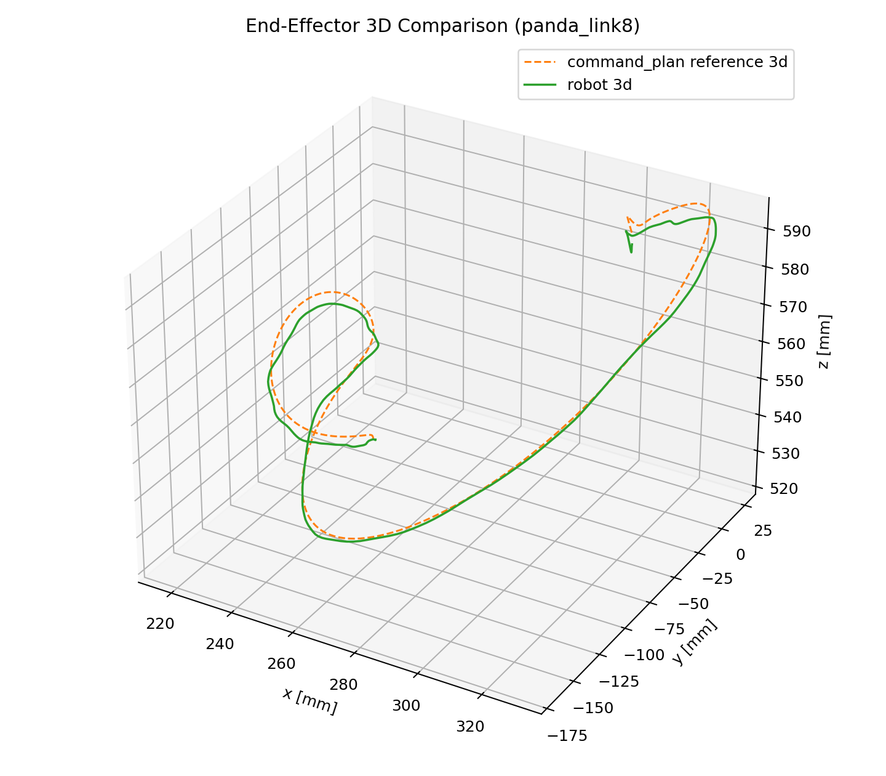 | 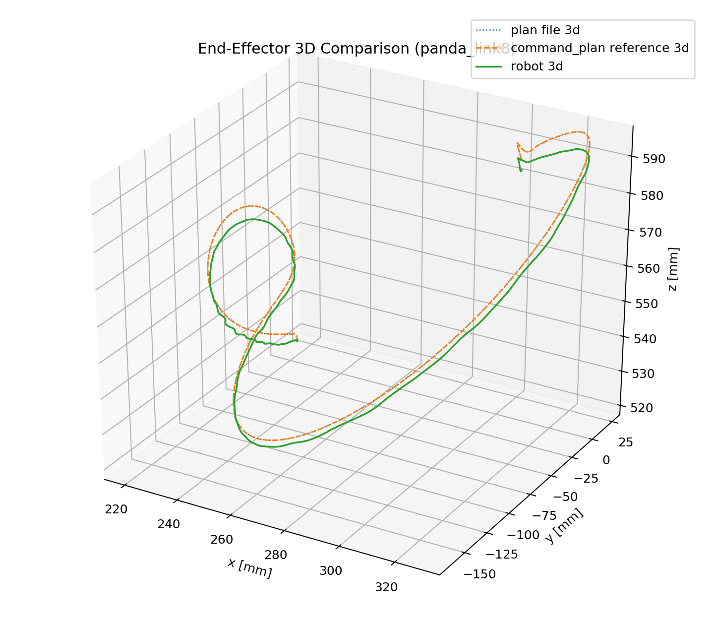 |

The [full trajectory gallery](hardware/trajectory_examples/README.md) also
includes matched training and held-out examples from Fig. 5, planar and
orientation-tracking tasks, and in-range and out-of-range payload examples
from Fig. 7.

## Manuscript figure numbering

The references and output filenames in this repository follow the current
manuscript, including the overall framework as Fig. 1.

| Figure | Content | Released data or reproduction |
|---|---|---|
| Fig. 1 | Overall method framework | Manuscript illustration; not generated from the released experiment data |
| Fig. 2 | Residual RL and direct torque RL learning curves | [Learning efficiency](simulation/learning_efficiency/README.md) |
| Fig. 3 | Staged component-ablation learning curves | [Component ablation](simulation/component_ablation/README.md) |
| Fig. 4 | Experimental setup and modular payload | Manuscript photographs; not generated from the released experiment data |
| Fig. 5 | Tracking errors, measured torque, and torque rate | [Tracking and torque](hardware/tracking_and_torque/README.md) |
| Fig. 6 | Circular-trajectory tracking example | [Circular trajectory](hardware/circular_trajectory/README.md) |
| Fig. 7 | Robustness to unmodeled payloads | [Payload robustness](hardware/payload_robustness/README.md) |

## Contents

```text
github_data/
|-- simulation/
|   |-- learning_efficiency/       # Fig. 2
|   |-- controller_comparison/     # Table II
|   `-- component_ablation/        # Fig. 3 and Table IV
|-- hardware/
|   |-- tracking_and_torque/       # Fig. 5
|   |-- circular_trajectory/       # Fig. 6
|   |-- dual_endpoint/             # Table V
|   |-- payload_robustness/        # Fig. 7
|   |-- trajectory_examples/       # Matched real-robot trajectory plots
|   `-- motion_replays/            # Measured robot motion replayed in MuJoCo
|-- processing/                    # Aggregation, plotting, and validation
|-- reproduced/                    # Regenerated tables and figures
|-- DATA_DICTIONARY.md
`-- requirements.txt
```

The simulation files contain training-time learning curves or one row per
reported evaluation. Hardware metric files contain one row per trajectory,
method, and condition, after averaging repeated runs when present.
The trajectory gallery also includes reduced plotting curves for the two
added baselines. These curves are not used to recompute the reported metrics.

## Data inclusion

The learning-curve files retain every recorded evaluation on the reported
training lineage, without smoothing or interpolation. For every learned
configuration, post-training evaluation uses the checkpoint with the highest
stored mean evaluation return within the prescribed training budget. The
simulation tables retain all three repeated evaluations of
each fixed controller. The
hardware tables retain every trajectory shared by the compared methods under
the corresponding condition. Repeats are averaged within each trajectory
before trajectories receive equal weight. As reported in the manuscript,
the comparisons in Figs. 5 and 6 use no added payload.

## Reproduce the results

From this directory, run:

```bash
python -m pip install -r requirements.txt
python processing/reproduce_results.py
python processing/plot_trajectory_examples.py
python processing/validate_release.py
```

The reproduction script regenerates Tables II, IV, and V and Figs. 2, 3, 5,
6, and 7 under `reproduced/`, including the circular-trajectory plotting step.
The Fig. 5 and Table V summaries are saved as
[`figure_5_tracking_torque_summary.csv`](reproduced/tables/figure_5_tracking_torque_summary.csv)
and [`table_v_dual_endpoint_ablation.csv`](reproduced/tables/table_v_dual_endpoint_ablation.csv).
The gallery script regenerates the added baseline
images from the released plotting summaries. Existing controller gallery
images are retained from the original release. Validation checks data schemas,
trajectory coverage, method names, portability, and agreement with the manuscript.

The optional [motion-replay renderer](processing/render_real_robot_replays.py)
uses the released joint traces, a Panda MuJoCo model, and FFmpeg. Its additional
dependencies and model requirements are documented in the
[replay gallery](hardware/motion_replays/README.md). The 18 released playback
CSVs are sufficient for rendering all six methods; the original plotting
archives and raw robot logs are not needed.
