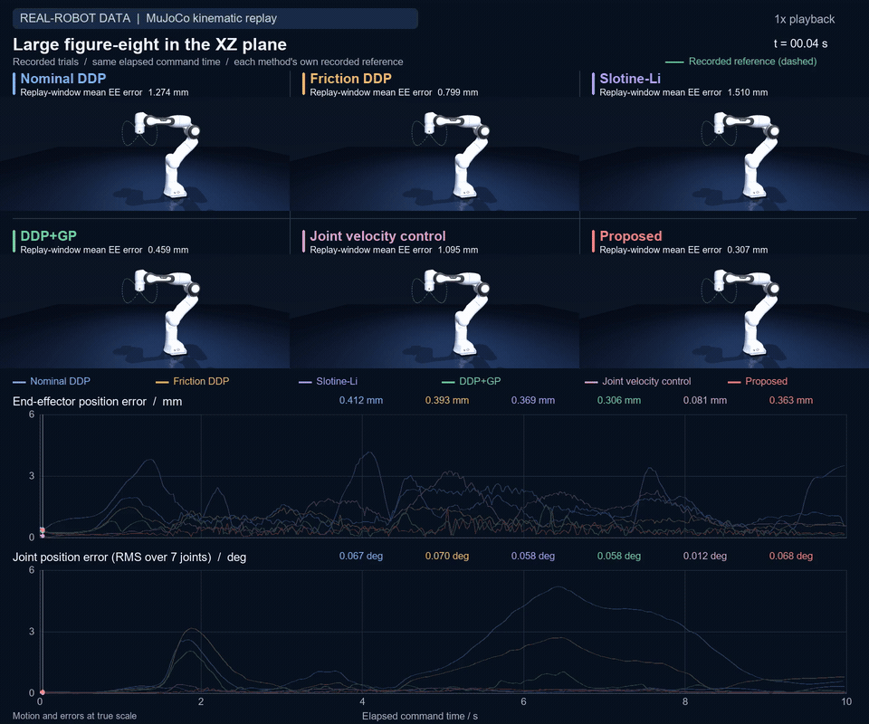
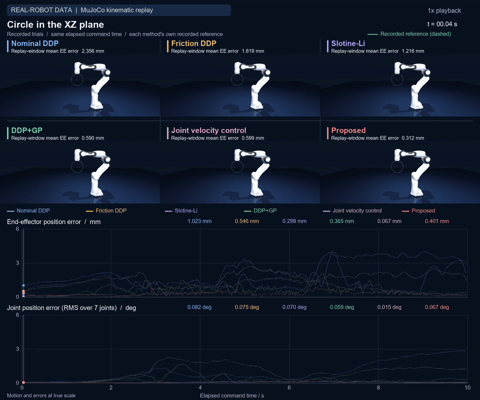
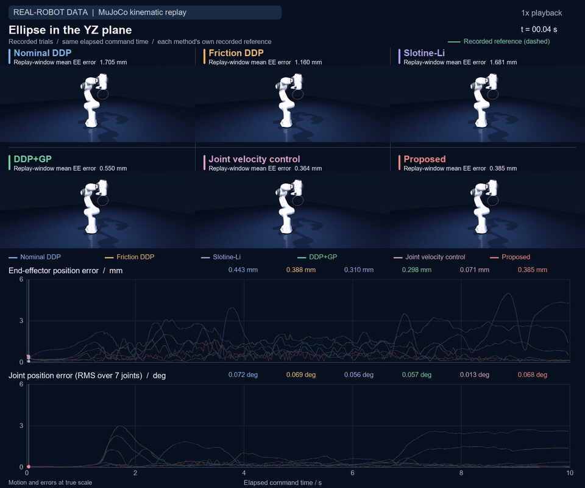

# Real-robot motion reconstructed in MuJoCo

These animations replay **measured real-robot joint positions** in a MuJoCo
model. They are not camera recordings or new controller simulations. All six
controllers in Fig. 5 appear in a three-column, two-row layout: Nominal DDP,
Friction DDP, Slotine–Li, DDP+GP, Joint velocity control, and Proposed. Playback
uses the original speed, the same camera, shared elapsed command time, and
common error axes. Each method has a distinct color, and each view retains
its own trial's recorded reference trajectory.

The examples were chosen for three different path geometries. They are
illustrative individual trials, not an aggregate ranking across the experiment.

## Large figure-eight in the XZ plane



[Full-resolution MP4](media/figure8_xz.mp4) · [Poster](media/figure8_xz_poster.png)

## Circle in the XZ plane



[Full-resolution MP4](media/circle_xz.mp4) · [Poster](media/circle_xz_poster.png)

## Ellipse in the YZ plane



[Full-resolution MP4](media/ellipse_yz.mp4) · [Poster](media/ellipse_yz_poster.png)

## What the animation shows

- Each method's color is consistent across its label, measured-motion trail,
  and error curves. Dashed reference traces belong to the individual trials
  and are evaluated in the `panda_link8` frame.
- Bright error curves show elapsed samples; faint curves show the remainder
  of the recorded trial for context. The cursor uses the same elapsed time
  as all six robot views.
- End-effector error is the Euclidean distance between forward kinematics of
  measured and recorded-reference joint positions, in mm. Joint error is the
  RMS across the seven joint-position errors at that instant, in degrees.
- The displayed **replay-window mean EE error** is the arithmetic mean of the
  native released samples within the replay window. It is not a full-rate
  paper result. Paper tables use the full experiment windows and their stated
  aggregation; the animations do not replace those tables.

No motion or error is magnified. All six methods share fixed axes of 0–6 mm
for end-effector position error and 0–6 deg for joint error. These ranges
include all peaks in the released examples. The underlying robot motion is
not smoothed or resimulated; only linear interpolation between available
joint samples is used to draw video frames.

## Data and timing

The 18 [playback CSV files](data/), one for each method and trajectory, contain
`time_s`, `q1_rad` through `q7_rad`,
and `q_ref1_rad` through `q_ref7_rad`. The measured states and reference states
come from historical hardware trials. Five methods use the original processed
plotting archive: Nominal DDP, Slotine–Li, DDP+GP, Joint velocity control, and
Proposed. Friction DDP was absent from that archive, so its traces were
extracted separately from the original ROS1 bag records, using each trial's
measured joints and recorded command reference. Its full-rate mean and peak
tracking errors were checked against the formal comparison results before
reducing the traces for playback.

The reduced sources select the first measured sample at or after each 25-ms
target time; the released files preserve the actual selected timestamps and
joint values. They are not complete high-rate logs. Each panel uses one
deterministically selected valid run of that method
on the displayed trajectory. When repeated trials are available, a single
run is selected without averaging; the selected run and selection rule are
recorded in the provenance.

The MP4s use 30 frames/s; the smaller GIFs use 10 frames/s. Joint angles are
interpolated only inside all six runs' common recorded interval. There is no
phase alignment, time warping, extrapolation, or replacement of one method's
reference with another's. The displayed clock remains elapsed command time.
The final video frame is held for one encoder frame period, so encoded duration
and the interval between the first and last sampled frames differ by 1/30 s.

The historical methods were recorded in separate sessions, and their command
reference timing differs slightly. Their own-reference error definitions are
preserved. These are matched trajectory examples, not a same-session causal
ablation. The historical records do not establish an independently verified
per-run added mass for every method, so no common per-run payload claim is
attached to these comparisons.

The error-curve cursor interpolates the native scalar errors, while each robot
pose interpolates joint angles before forward kinematics. The nonlinearity of
forward kinematics can create a small interpolation difference between these
two display quantities. Native samples and summary metrics are unchanged.

[provenance.json](provenance.json) records source and output SHA-256 hashes,
selected runs, timing windows, source-to-model kinematic checks, renderer
settings, and replay-window statistics. No policy inference, torque command,
or dynamics integration is used to produce the animation.

## Reproduce the animation

Install [requirements_replay.txt](../../processing/requirements_replay.txt)
and FFmpeg/FFprobe. Pandas, ROS, Pinocchio, robot hardware, and policy
checkpoints are not needed. The provided renderer reads the 18 released CSVs;
ordinary reproduction requires neither the original plotting archives nor
the raw robot logs.

The small validated XML and its existing Apache-2.0 license are included in
[model/](model/). The 32-MB mesh collection remains external. See
[model/README.md](model/README.md) for the upstream source and setup. From the
release root, with those assets available:

```bash
python processing/render_real_robot_replays.py --model hardware/motion_replays/model/panda_nohand.xml --assets path/to/franka_emika_panda/assets
```

Use `--preview` for still frames, `--case figure8_xz` for one example, and
`--font path/to/font.ttf` to select a font. Arial or DejaVu Sans is used when
available. MP4s and posters use 1920×1600 pixels; GIFs use 960×800 pixels.

The bundled model is copied from the project's
`mjcf/franka_emika_panda/panda_nohand.xml`. Model and referenced-mesh SHA-256
hashes are recorded and checked during reproduction. Its seven-joint order
and `panda_link8_site` are preserved. The Panda description is derived from
the Franka description; the existing model package carries the Apache-2.0 license.
The display scene adds only lighting and a floor, with no inferred payload
geometry or physics.

The renderer is [render_real_robot_replays.py](../../processing/render_real_robot_replays.py).
For maintainers rebuilding the playback CSVs, `--source` supplies the original
five-method `plot_series_25ms.csv.gz`, and `--source-summary` supplies its
`per_trajectory.csv`. The six-method import also needs the separate Friction
DDP export through `--extra-source` and its extraction evidence through
`--source-evidence`:

```bash
python processing/render_real_robot_replays.py \
  --model hardware/motion_replays/model/panda_nohand.xml \
  --assets path/to/franka_emika_panda/assets \
  --source path/to/plot_series_25ms.csv.gz \
  --source-summary path/to/per_trajectory.csv \
  --extra-source path/to/additional/additional_plot_series.csv.gz \
  --source-evidence path/to/additional/provenance.json \
  --preview
```

Repeat `--extra-source` when supplying multiple supplementary exports with
the same columns. The import checks forward-kinematic positions and EE errors
against the supplied source traces before writing the playback CSVs. The
additional evidence records the Friction DDP extraction and full-rate checks.
These source inputs are only for maintainers; public replay generation uses
the 18 released CSVs without any original trial archive.
